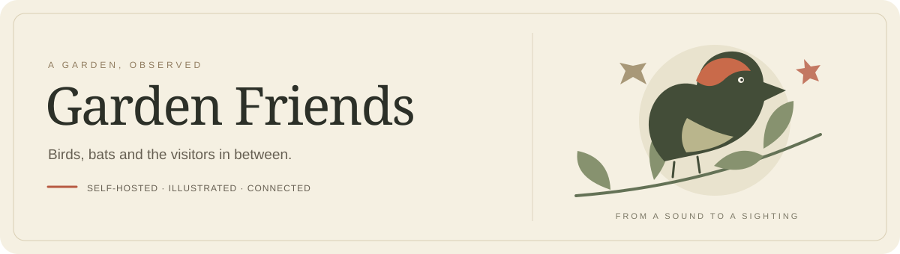
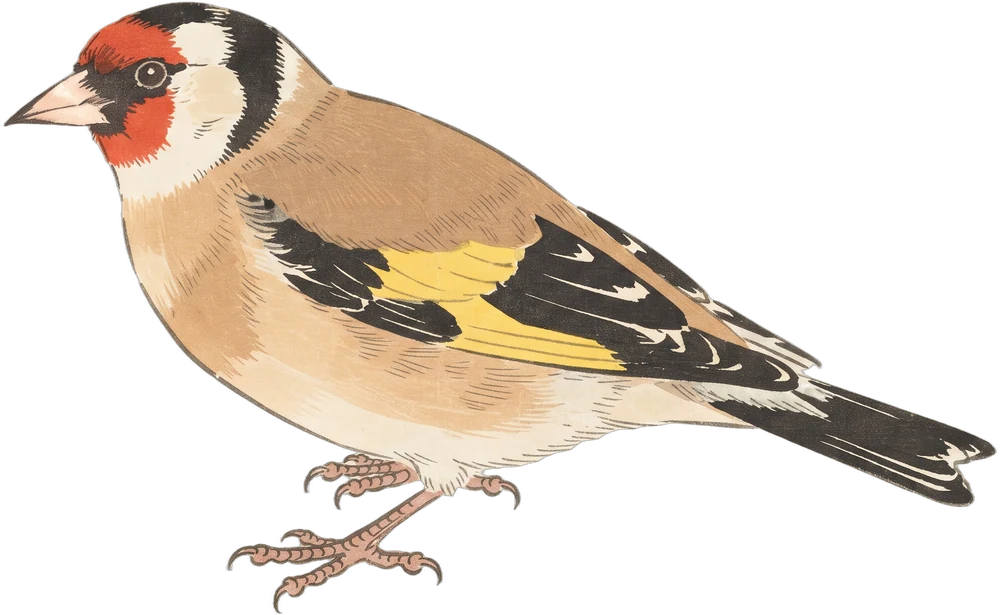
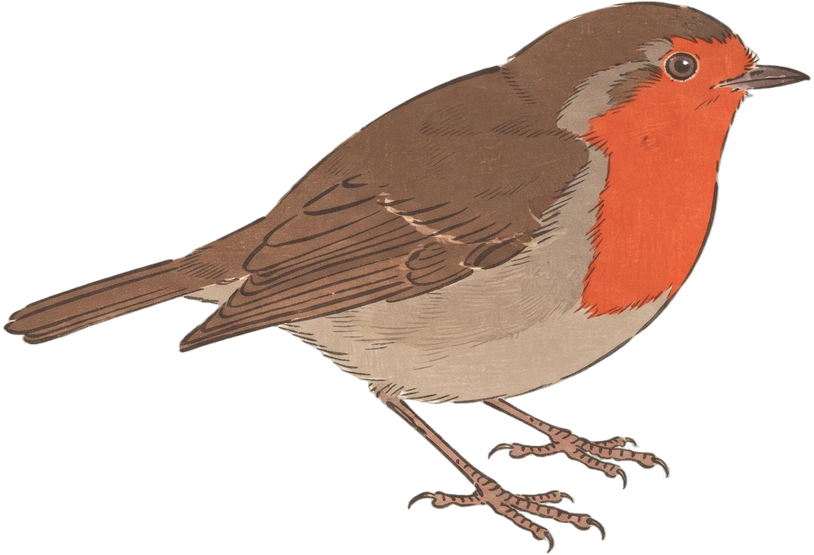
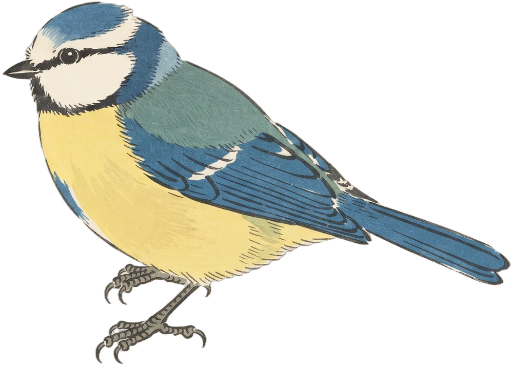
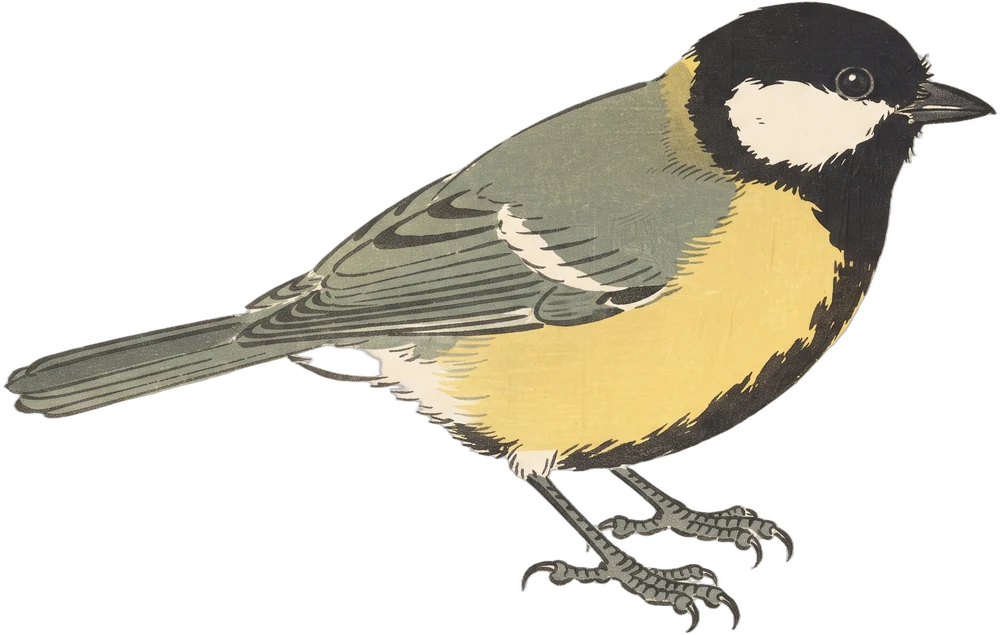
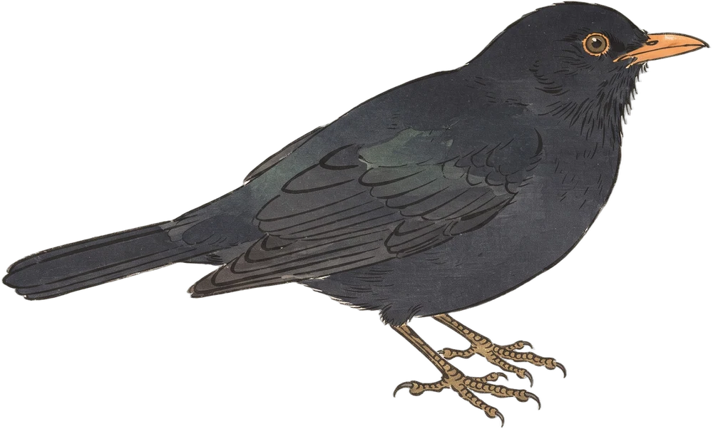
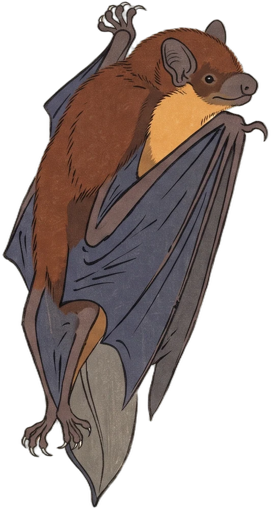
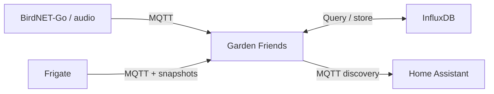

<p align="center">
  
</p>

<p align="center">
  <strong>BirdNET &amp; Frigate</strong> &nbsp; · &nbsp; <strong>InfluxDB</strong> &nbsp; · &nbsp; <strong>MQTT</strong> &nbsp; · &nbsp; <strong>Home Assistant</strong>
</p>

<p align="center">
  <a href="#what-you-get">Features</a> &nbsp; / &nbsp;
  <a href="#get-started">Get started</a> &nbsp; / &nbsp;
  <a href="#connect-your-garden">Connections</a> &nbsp; / &nbsp;
  <a href="#the-artwork">Artwork</a> &nbsp; / &nbsp;
  <a href="docs/PUBLISHING.md">Publish to GitHub</a>
</p>

## Your garden, brought together

**Garden Friends** turns wildlife detections into an illustrated record of the animals around your home. A changing collage shows your visitors; the statistics view brings their activity, detection sources and patterns into focus.

Connect an existing InfluxDB catalogue, or receive detections from BirdNET-Go and Frigate through MQTT. Configure the connections in your browser, keep your artwork with the project, and let each new day begin at **midnight in your chosen timezone**.

<!-- GARDEN_FRIENDS_ARTWORK_GALLERY_START -->

<table><tr>
<td align="center" width="16%"><br><sub>Goldfinch</sub></td>
<td align="center" width="16%"><br><sub>European Robin</sub></td>
<td align="center" width="16%"><br><sub>Blue Tit</sub></td>
<td align="center" width="16%"><br><sub>Great Tit</sub></td>
<td align="center" width="16%"><br><sub>Blackbird</sub></td>
<td align="center" width="16%"><br><sub>Common Pipistrelle</sub></td>
</tr></table>

<!-- GARDEN_FRIENDS_ARTWORK_GALLERY_END -->

## What you get

| A living display | Useful detail | A manageable installation |
| --- | --- | --- |
| Illustrated birds, bats and other wildlife | Species counts and activity timelines | Connection settings in the browser |
| Perched, ground and flight poses | BirdNET, Perch, bat and camera source filters | Password-protected administration |
| Responsive collage and statistics views | Estimated dwell and mixed-species co-occurrences | Docker Compose deployment |
| Your complete static artwork collection | Today, earlier days and longer time windows | Verified artwork and release manifests |

Garden Friends receives classifications from your existing detectors. BirdNET-Go and Frigate perform the audio or image inference; the dashboard does not need a GPU or a local language model to display their results.

## Get started

### 1. Start the application

Download or clone this repository, then run from its root:

```bash
docker compose up -d --build
docker compose logs garden-friends
```

Open **`http://YOUR_SERVER:8090`**. The collage and statistics pages are public views; opening them does not require the administrator password.

If port 8090 is already in use, copy `.env.example` to `.env`, change `GARDEN_FRIENDS_PORT` to an available port such as `8092`, and start the stack again. Connection credentials are configured in the web page.

### 2. Create your administrator

Open **Statistics → Settings**. The first startup prints a one-time setup code in the application log. Enter it and choose an administrator password of at least 12 characters.

The setup code is removed after the administrator is created. A normal settings login uses your password, and changing the password revokes existing administrator sessions.

### 3. Connect your services

Start with **InfluxDB**, then test the connection. Add MQTT and any optional integrations you use. Save the settings; Garden Friends briefly restarts its application process and reconnects with the new values.

The initial mode is **read-only**. This lets you display and check an existing catalogue before enabling ingestion. Enable ingestion only for the instance you want to receive detections and write them to InfluxDB.

> **Already running Avian Visitors?** Use a different host port for your first Garden Friends check and leave Garden Friends in read-only mode. Choose which instance will own ingestion before switching it on. The release builder does not stop, replace or reconfigure your existing website.

## Connect your garden

All connection settings are available from **Statistics → Settings**.

| Connection | What you configure | When you need it |
| --- | --- | --- |
| **InfluxDB 2.x** | Server URL, organisation, bucket, token and timeout | To display or store the detection catalogue |
| **MQTT** | Broker, port, credentials, client ID and TLS | To receive live detections and publish integration state |
| **BirdNET-Go / audio detectors** | Subscribed topics and missing-confidence handling | For bird, bat and other supported audio detections |
| **Frigate** | Server URLs, token, MQTT topic prefix and confidence thresholds | For camera classifications and snapshots |
| **Home Assistant** | Discovery enabled/disabled and discovery prefix | For MQTT-discovered wildlife entities; it uses the same broker |
| **Display and operation** | Public site URL, timezone, read-only mode and refresh/cache intervals | To match your installation and its day boundary |

The **Test connection** actions check InfluxDB, MQTT and Frigate without inserting detections or publishing test events. Saved tokens and passwords are never returned to the browser. Leaving a secret field blank preserves it; use the explicit **Clear** control to remove it.

### What the pipeline looks like



InfluxDB, the MQTT broker and your detectors run separately. Garden Friends does not create a new database or alter your existing detector configuration. See [Deployment](docs/DEPLOYMENT.md) for network, persistence and upgrade details.

## Midnight means midnight

The daily display follows the selected timezone rather than a fixed UTC offset. In `Europe/London`, a detection at **23:59** belongs to the current day; a detection at **00:00** starts the next one.

Daylight-saving changes are handled as local calendar days, so a day can span 23 or 25 elapsed hours. The setting changes the window used to display detections; it does not rewrite stored detection timestamps.

The **Today** statistics and Home Assistant daily summary use the same midnight boundary. The historical `wildlife/summary_24h` compatibility topic follows that daily window too; it is not a separate rolling 24-hour total.

## The artwork

The release contains the complete static artwork collection exported from the selected artwork folder: source PNGs, WebP versions, flight poses, aliases, favicon images and the masks or ratio metadata needed by the collage. Files retain their original names and bytes.

- **`species_art/`** contains the images and static artwork metadata.
- **`ARTWORK_MANIFEST.json`** records every included artwork file, byte size and SHA-256 checksum.
- **`BUILD_REPORT.json`** gives the image count, export totals and whether any file requires Git LFS.
- **`RELEASE_MANIFEST.json`** covers the complete distribution.

Camera captures, live snapshots, passwords, database files and backup folders are runtime data, so they stay out of the public distribution. Runtime snapshots and administrator settings use the persistent data volume; the bundled artwork is mounted read-only.

Verify an unmodified exported release before uploading it:

```bash
python tools/verify_release.py
```

The visual collage uses available silhouettes and alias mappings. Dwell and co-occurrence values are estimates from detection timing, rather than direct measurements of an animal's residence or social behaviour.

## Publishing your distribution

The export creates a **`garden-friends/` repository folder**, a **`garden-friends.zip`** release archive and a checksum file. Upload the contents of the repository folder to GitHub; the ZIP can also be attached to a release.

Use [the publishing guide](docs/PUBLISHING.md) for GitHub Desktop, Git commands and large artwork files. The builder adds Git LFS rules when any individual file exceeds GitHub's regular-Git file limit. Keep the generated `.gitattributes` file if those rules are present.

The project name is **Garden Friends**. The author profile link in the public display points to [ranolph](https://github.com/ranolph).

## Project layout

```text
main.py                       Wildlife catalogue, collage and statistics
garden_friends_settings.py    Administration and persisted connection settings
server.py                     Application runner and managed restarts
static/                       Settings page assets
species_art/                  Complete static illustration collection
docs/                         Deployment and publishing guides
tools/                        Release export and checksum verification
tests/                        Application, settings and packaging checks
compose.yaml                  Container deployment
```

## Development

For a local Python environment:

```bash
python -m venv .venv
# Activate your virtual environment, then:
python -m pip install -r requirements-dev.txt
python server.py
```

Run the checks with `python -m pytest -q tests`. See [CONTRIBUTING.md](CONTRIBUTING.md) for the change and review expectations, and [SECURITY.md](SECURITY.md) for administration and reporting guidance.

## Credits and rights

Garden Friends builds on the Avian Visitors wildlife catalogue and the detections supplied by [BirdNET-Go](https://github.com/tphakala/birdnet-go), [Frigate](https://frigate.video/), [InfluxDB](https://www.influxdata.com/) and [Home Assistant](https://www.home-assistant.io/).

Code and artwork retain their respective copyrights. No open-source or artwork redistribution licence has been selected for this release; see [NOTICE.md](NOTICE.md).
